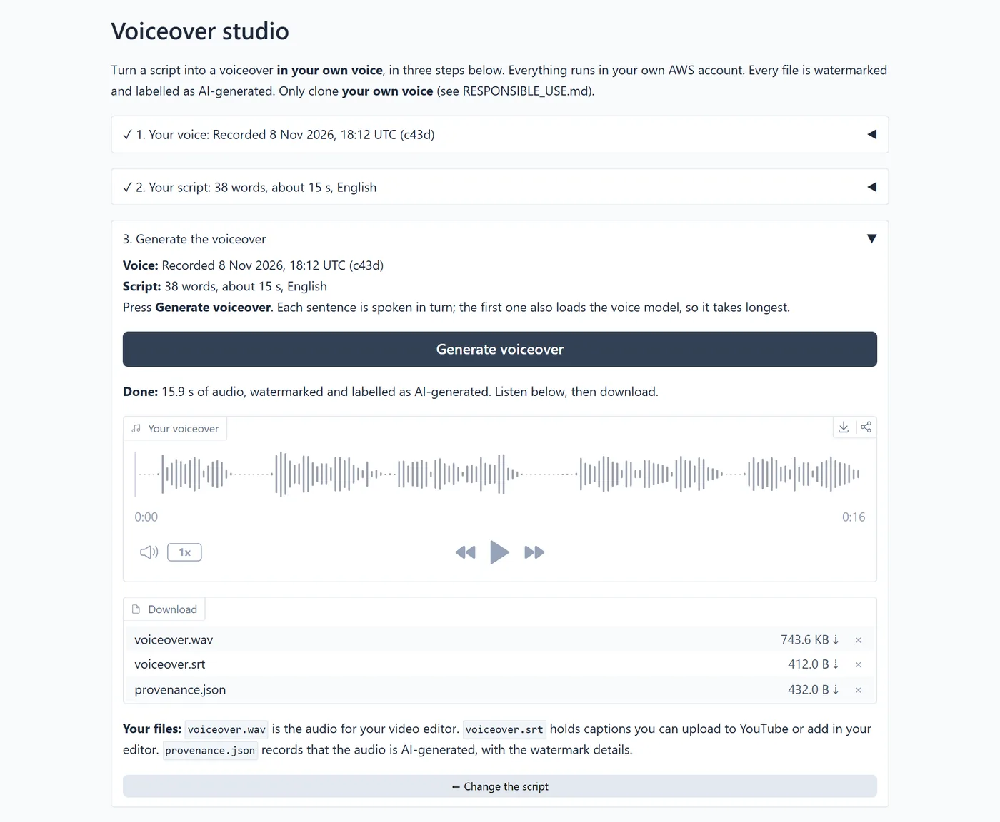

# voiceover-studio

[](https://github.com/WornKeys/voiceover-studio/actions/workflows/ci.yml)
[](https://github.com/WornKeys/voiceover-studio/actions/workflows/security.yml)
[](https://github.com/WornKeys/voiceover-studio/releases)
[](LICENSE)

**Your own voice, your script, your AWS account.**

Describe your video, let an open-weight LLM draft the script, edit it, and get a voiceover read in **your own
cloned voice**, with captions. Everything runs on one GPU server in your own AWS account: your voice sample and
scripts never leave it.



<sub>The voice in this screenshot was designed by a model from a text description. It belongs to no real person.</sub>

> **Status:** [`v1.0.0`](https://github.com/WornKeys/voiceover-studio/releases/tag/v1.0.0), tested end to end on
> AWS in November 2026 (set up, record, write, generate, remove everything). The walkthrough is the three-part
> *AI Voiceover Studio* series on wornkeys.dev:
> [1. voice cloning and running it](https://wornkeys.dev/keystrokes/ai-voiceover-studio-voice-cloning/) ·
> [2. the pipeline and UI](https://wornkeys.dev/keystrokes/ai-voiceover-studio-pipeline-and-ui/) ·
> [3. the AWS side and costs](https://wornkeys.dev/keystrokes/ai-voiceover-studio-aws-and-costs/).

## Contents

[What it does](#what-it-does) · [Features](#features) · [How it works](#how-it-works) ·
[Models and licences](#models-and-licences) · [Before you start](#before-you-start) · [Quick start](#quick-start) ·
[What it costs](#what-it-costs) · [Security and your data](#security-and-your-data) ·
[Use it responsibly](#use-it-responsibly) · [Documentation](#documentation) ·
[Known issues and limits](#known-issues-and-limits) · [Development](#development) ·
[How this was built](#how-this-was-built)

## What it does

The studio is one guided page in three steps:

1. **Your voice.** Read a short consent sentence aloud, recorded in the browser or uploaded (WAV, MP3, M4A). That
   recording is both the consent record and the sample your voice is cloned from.
2. **Your script.** Describe the video, its audience, tone and length. The LLM drafts a script written for the
   ear; you edit it until it says what you want.
3. **Your voiceover.** The script is spoken in your cloned voice, sentence by sentence, then joined, levelled and
   watermarked. You get:
   - `voiceover.wav`: the audio for your video editor
   - `voiceover.srt`: captions for YouTube or your editor
   - `provenance.json`: a record that the audio is AI-generated, with the watermark details

## Features

- **Voice cloning from 5 to 15 seconds of speech**, with the recording checked for length, clipping and silence.
- **Scripts and voiceovers in 10 languages:** English, Chinese, Japanese, Korean, German, French, Russian,
  Portuguese, Spanish and Italian (the ones the voice model supports).
- **A script you control:** the LLM drafts it, you edit it, and the page shows its length in words and seconds
  before anything is generated.
- **Plugins** that add steps without touching the core: `fit_to_length` rewrites the script to hit a target
  duration (enabled by default), `translate` translates it into another supported language (add it to `PLUGINS`
  in `.env`). The UI builds their controls by itself. [Write your own](docs/plugins.md).
- **A voice library:** saved voices are reused across sessions, and deleting one removes the recording from your
  bucket.
- **Guardrails in the code, not in settings:** a consent check before any cloning, an inaudible
  [AudioSeal](https://github.com/facebookresearch/audioseal) watermark and an "AI-generated" label on every file,
  and a refusal to write scripts that impersonate named people. `scripts/check_watermark.py` finds the mark in
  any audio or video file.
- **Swappable models:** the voice model, the script writer, speech-to-text and storage are *providers* picked in
  `.env`. The script writer can be any OpenAI-compatible endpoint.
- **Costs that stay small:** the instance stops itself when idle, a CloudWatch alarm backs that up, a budget emails
  you, and `destroy.sh` removes everything and checks that nothing is left.

## How it works

```
record / upload your voice ─▶ consent + quality check ─┐
describe the video ─▶ LLM drafts script ─▶ you edit + approve ─▶ plugins ─▶ text-to-speech in your voice
                                                                                       │
              voiceover.wav + voiceover.srt + provenance.json ◀─ loudness + watermark ─┘
```

One GPU instance runs two containers: the app (FastAPI + Gradio, the voice model, Whisper, AudioSeal) and vLLM
serving the script writer. It has **no inbound ports**: you reach the UI through an AWS Session Manager tunnel at
`http://localhost:7860`, which is also why the browser allows the microphone. Voices and outputs live in a
private, encrypted S3 bucket in your account.

The code is a fixed **core** (the workflow and the guardrails), **providers** behind interfaces (voice, LLM,
speech-to-text, storage) and **plugins** (new steps). Swapping a model or adding a plugin can't bypass the
guardrails. The full picture, with diagrams of the system, the deploy and the instance lifecycle:
[docs/architecture.md](docs/architecture.md).

## Models and licences

Downloaded at deploy time, never stored in this repo, and pinned to tested revisions:

| Job | Model | Licence | Runs on |
|---|---|---|---|
| Voice | [Qwen3-TTS 1.7B Base](https://huggingface.co/Qwen/Qwen3-TTS-12Hz-1.7B-Base) | Apache-2.0 | GPU, ~8 GB |
| Script | [Qwen3.5-9B, 4-bit AWQ](https://huggingface.co/cyankiwi/Qwen3.5-9B-AWQ-4bit) on vLLM v0.32.0 | Apache-2.0 | same GPU, ~half of 24 GB |
| Consent check | [faster-whisper `small`](https://huggingface.co/Systran/faster-whisper-small) | MIT | CPU |
| Watermark | [AudioSeal](https://github.com/facebookresearch/audioseal) | MIT | GPU or CPU |

Exact revisions and where each pin is set: [docs/architecture.md § Pinned versions](docs/architecture.md#8-pinned-versions).
Check each licence yourself before commercial use.

## Before you start

- **An AWS account** where you can use an admin profile once for the setup. An existing account works; the
  guardrails apply only to this project's own deploy role.
- **A GPU quota of 4 vCPUs** ("Running On-Demand G and VT instances" in us-east-1). `bootstrap.sh` requests it,
  but AWS approves it, which can take **hours to days**: start here.
- **Docker** (Docker Desktop on Windows and macOS) and the **AWS CLI v2 ≥ 2.32**. Terraform and the Session
  Manager plugin come in a toolbox container, so you don't install them.
- **Bash:** macOS and Linux have it. On Windows, use Git Bash, or a WSL distribution that has Docker and your AWS
  profiles.
- **A browser for recording:** Firefox, Chrome or Edge. Not Brave (see [Known issues](#known-issues-and-limits)).

## Quick start

```bash
cp .env.example .env                       # set BUDGET_EMAIL; everything else has a default
./scripts/bootstrap.sh --profile <admin>   # once per AWS account: guardrails, deploy role, budget, GPU quota
aws login --profile voiceover-operator     # short-lived credentials, no access keys
./scripts/deploy.sh                        # asks before creating anything; first time about 25 minutes
./scripts/connect.sh                       # then open http://localhost:7860
./scripts/destroy.sh                       # when you're done: removes everything and checks
```

Between sessions, `./scripts/stop.sh` keeps everything and stops the GPU; `connect.sh` starts it again. The full
guide, with daily use and troubleshooting: [docs/deploy.md](docs/deploy.md). The account setup, piece by piece:
[infra/bootstrap/README.md](infra/bootstrap/README.md).

## What it costs

us-east-1 on-demand prices; check your region.

| | Cost |
|---|---|
| g6.xlarge (NVIDIA L4, 24 GB) while running | ≈ $0.80 / hour |
| 150 GB disk, running or stopped | ≈ $12 / month |
| A one-time try: deploy, two hours of use, destroy | ≈ $2 to $4 |
| A minute of finished voiceover | ≈ $0.01 of GPU time (measured) |
| Left running for a month by mistake | ≈ $600, which is what the four layers below are for |

Four layers stand between you and that last line: the app's idle auto-stop (30 minutes by default), a CloudWatch
alarm on low CPU, budget emails, and a GPU quota that allows only one instance. Measured times and every AWS
service involved: [docs/deploy.md § What it costs](docs/deploy.md#what-it-costs) and
[docs/aws-services.md](docs/aws-services.md).

## Security and your data

- **Nothing is public.** No inbound ports, IMDSv2 only, an encrypted disk and bucket, TLS-only bucket access.
- **Least privilege.** The scripts run as a deploy role (MFA required) that can only create this project's
  resources, in one region, with the allowed instance types. The instance's own role is capped by a permissions
  boundary.
- **Your voice stays yours.** Voice samples and outputs are in your private bucket; no telemetry, no hosted demo.
  Deleting a voice in the UI deletes the recording.
- **Checked on every push:** CodeQL, OSV-Scanner on the lockfile, Trivy on the infrastructure, gitleaks over the
  whole history, and a check that keeps audio files out of git. Reviewed findings and why they don't apply:
  [SECURITY.md](SECURITY.md).
- **Found a problem?** Report it privately through the **Security** tab: [SECURITY.md](SECURITY.md).

## Use it responsibly

Clone **only your own voice**, or a voice whose owner has explicitly agreed through the consent step. Tell your
audience the voice is AI-generated: several platforms require it. Impersonation, fraud, deception and removing the
watermark or label are not permitted. The details, the safeguards and their limits:
[RESPONSIBLE_USE.md](RESPONSIBLE_USE.md).

## Documentation

| I want to… | Read |
|---|---|
| Deploy it, use it day to day, fix a problem | [docs/deploy.md](docs/deploy.md) |
| Set up an AWS account for it | [infra/bootstrap/README.md](infra/bootstrap/README.md) |
| Know every AWS service it uses and what each costs | [docs/aws-services.md](docs/aws-services.md) |
| Understand the design, configuration and CI | [docs/architecture.md](docs/architecture.md) |
| Follow one voiceover through the code | [docs/learn/01-how-a-voiceover-is-made.md](docs/learn/01-how-a-voiceover-is-made.md) |
| See how the UI is built and tested | [docs/learn/02-the-ui.md](docs/learn/02-the-ui.md) |
| Read the Terraform, file by file | [docs/learn/03-terraform.md](docs/learn/03-terraform.md) |
| See what `deploy.sh`, `connect.sh` and `destroy.sh` actually do | [docs/learn/04-deploy-and-run.md](docs/learn/04-deploy-and-run.md) |
| Write a plugin | [docs/plugins.md](docs/plugins.md) |
| Know what's allowed | [RESPONSIBLE_USE.md](RESPONSIBLE_USE.md) |
| Report a vulnerability or misuse | [SECURITY.md](SECURITY.md) |
| Read the ideas and decisions behind it | The series on [wornkeys.dev](https://wornkeys.dev/keystrokes/ai-voiceover-studio-voice-cloning/) |

## Known issues and limits

- **Brave:** microphone recording freezes, because Brave's fingerprinting protection alters the audio data pages
  read. Use Firefox, Chrome or Edge, or upload a recording made with another app.
- **Output is WAV, SRT and provenance.json.** No MP3 export yet; your video editor converts the WAV.
- **Single user.** No logins or sharing: one person, one AWS account. Teams are out of scope.
- **No hosted demo,** by design: you run it in your own account or not at all.
- **The script writer runs locally** (vLLM). The adapter speaks to any OpenAI-compatible endpoint, but Amazon
  Bedrock also needs IAM permissions that aren't in `v1.0.0` yet.
- **Held-back dependencies:** `qwen-tts` 0.1.1 pins older pillow, transformers and accelerate, and gradio 6.17.3.
  Dependabot shows open alerts for them; each is reviewed in [SECURITY.md](SECURITY.md).
- More, with what's planned: [docs/architecture.md § Known gaps](docs/architecture.md#9-known-gaps).

## Development

```bash
uv sync                      # Python 3.12 + dev tools
uv run pytest                # about 90 tests, no GPU, models or network needed
uv run ruff check . && uv run ruff format --check .
uv tool install pre-commit && pre-commit install   # no audio, ruff and gitleaks on every commit
uv sync --extra gpu          # optional: the real models (Linux + NVIDIA GPU; CPU works, slowly)
```

Run the app locally, add a provider, change the infrastructure: [docs/architecture.md § Working on it](docs/architecture.md#7-working-on-it).
Bugs and ideas are welcome as [issues](https://github.com/WornKeys/voiceover-studio/issues); security problems
go through the Security tab instead. Never commit a real person's voice: the checks will refuse it.

| Path | What |
|---|---|
| `voiceover_studio/core/` | The fixed workflow: script, chunking, consent, watermark, render |
| `voiceover_studio/providers/` | Provider interfaces (TTS, LLM, speech-to-text, storage) and the registry |
| `voiceover_studio/plugins/` | Plugins: `fit_to_length`, `translate` |
| `config.yaml`, `.env.example` | App tuning and deployment settings |
| `Dockerfile`, `docker/compose.yaml` | The app image and the two containers on the instance (app + vLLM) |
| `infra/bootstrap/` | One-time account setup: guardrail policies, deploy role, operator user |
| `infra/terraform/`, `infra/instance/` | AWS resources; install/update and idle auto-stop on the instance |
| `scripts/*.sh`, `toolbox/` | Bootstrap, deploy, connect, start, stop, status, secrets, destroy (run in a toolbox container) |
| `scripts/check_watermark.py`, `scripts/check_no_audio.py` | Find the watermark in a file; keep recordings out of git |
| `tests/` | Unit, API and UI tests with fakes |

## How this was built

I built this with [Claude Code](https://claude.com/claude-code) as an AI pair programmer. I designed the system
and its guardrails, made the decisions and tested everything on a real AWS account; Claude Code wrote much of the
code and documentation under my direction and review. Commits it helped with carry a `Co-Authored-By` line.

## Licence

MIT for this code ([LICENSE](LICENSE)). The models are downloaded at deploy time under their own licences (see
[Models and licences](#models-and-licences)). Release notes: [Releases](https://github.com/WornKeys/voiceover-studio/releases).
