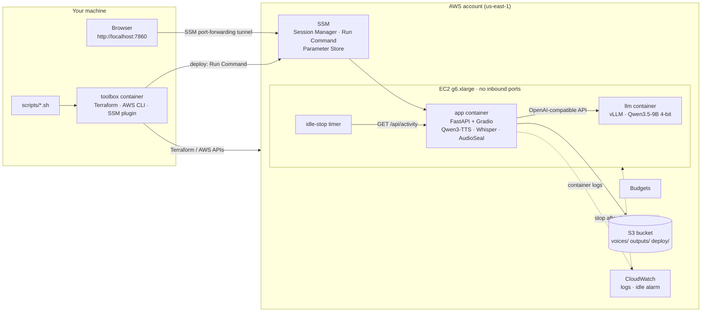
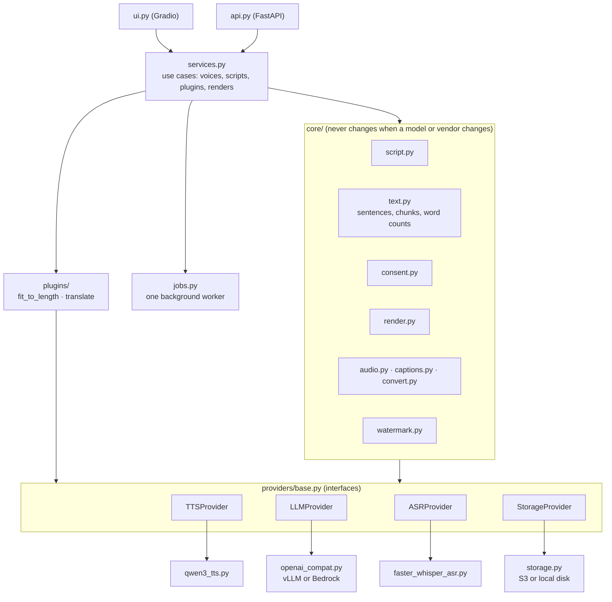
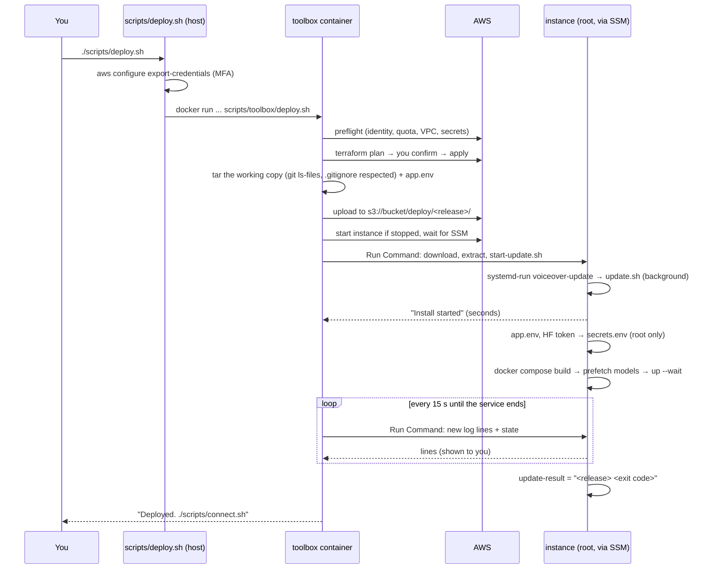
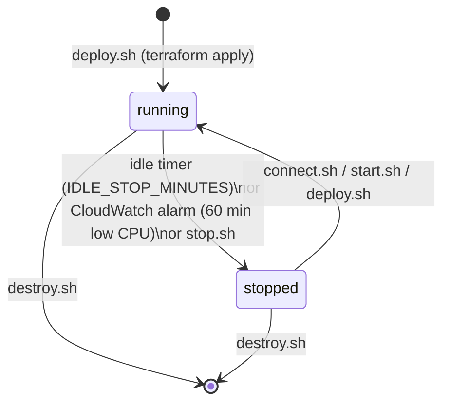

# Architecture and developer guide

How voiceover-studio is put together, why, and how to work on it. For deploying and day-to-day use, see
[deploy.md](deploy.md). For the AWS services involved and what each one costs, see
[aws-services.md](aws-services.md).

## 1. What it does

A single-user web app, running in your own AWS account:

1. **Voice:** you read a fixed consent sentence aloud (record in the browser or upload). The recording is both the
   consent record and the reference for cloning your voice.
2. **Script:** you describe the video, a local LLM drafts a script, you edit it. Optional plugins rewrite it
   (fit to length, translate).
3. **Voiceover:** the script is spoken in your cloned voice, sentence by sentence, then joined, levelled and
   watermarked. You download `voiceover.wav`, `voiceover.srt` (captions) and `provenance.json`.

## 2. System overview



Key properties:

- **Nothing is public.** The security group has no inbound rules. The UI is reached through an SSM tunnel, which
  also makes it `http://localhost`, a secure context, so the browser allows microphone recording.
- **One GPU, two models.** vLLM takes about half of the 24 GB (the LLM is ~9 GB plus its cache); the voice model
  uses ~8 GB of the rest. Whisper runs on the CPU.
- **Data stays in the account.** Voices and outputs live in a private, encrypted bucket. No telemetry, no hosted
  demo. A hosted provider (when added) is the only way data leaves, and the UI says so.

## 3. Application design: a stable core, replaceable providers, plugins



| Layer | Rule |
|---|---|
| **Core** (`voiceover_studio/core/`) | The workflow and the guardrails: consent check, script checks, chunking, loudness, watermark, labels, captions. Only talks to provider *interfaces* |
| **Providers** (`voiceover_studio/providers/`) | Swap *how* a fixed job gets done. Each declares its **capabilities** (languages, sample rate, max characters per call, runs locally or not), and the core and UI read them instead of assuming. Picked in `.env` (`TTS_PROVIDER`, `LLM_BASE_URL`, ...) via `settings.py` and `registry.py` |
| **Plugins** (`voiceover_studio/plugins/`) | Add *new* capabilities at a stage (`script`, `audio`, `output`). Settings are a pydantic model; the UI builds controls from its JSON schema. Guide: [plugins.md](plugins.md) |
| **Entry points** | `api.py` (HTTP, validation, status codes), `ui.py` (Gradio), `__main__.py` (mounts the UI on the API app), `prefetch.py` (deploy-time model download) |

**The UI is one guided page** (`ui.py`): three numbered steps (voice → script → generate). Each says what to do,
collapses to a one-line summary when done ("✓ 1. Your voice: Recorded 8 Nov 2026, 11:42 UTC") and opens the
next. Every field has a short explanation, and step 3 shows which voice and script will be used before
generating. With a saved voice, step 1 starts done. The step handlers are plain functions, so
`tests/test_ui.py` drives the whole flow without a browser (through `Blocks.fns`).

**Guardrails live in the core**, so swapping a provider or adding a plugin can't bypass them:

- No cloning without a consent record. Whisper transcribes the recording and it must match the sentence
  (`consent_match_threshold`).
- Script requests that ask to impersonate someone are refused, both before the LLM call and by the LLM's instructions.
- Every output is watermarked (AudioSeal, 16-bit message) and labelled "AI-generated" in the WAV metadata and
  `provenance.json`. This is not a setting.

### Main flows

**Add a voice:** upload → convert to 24 kHz mono WAV (ffmpeg) → quality checks (length, clipping, silence) and
trim → Whisper transcript → consent match → store `voices/<id>/sample.wav` + `consent.json`.

**Render:** `render_voiceover` splits the script into sentence chunks (`text.chunk_text`, CJK-aware) → TTS per
chunk (progress reported to the job) → join with pauses → loudness normalisation (−16 LUFS) → watermark → write
WAV (with label) + SRT + provenance → upload to `outputs/<id>/`.

**Idle tracking:** `ActivityTracker` (in `api.py`) records page loads and every non-GET request. Background polling
from an open tab doesn't count. `/api/activity` returns `idle_seconds` and `busy` (a render is queued or running).

## 4. Configuration

| Where | What | Read by |
|---|---|---|
| `.env` (your copy of `.env.example`) | Deployment choices: AWS profile, region, instance type, budget, idle minutes, providers, models, plugins. **Names** of secrets only | `scripts/toolbox/lib.sh` (`load_env`) → Terraform variables and `app.env` |
| `app.env` on the instance (`/opt/voiceover/app.env`) | The non-secret subset the app needs, written by `deploy.sh` | Docker Compose (`env_file`) → `Settings.from_env()` (`settings.py`) |
| SSM Parameter Store `/voiceover-studio/*` | Secrets (HF token, API keys) as SecureString | `ssm.py` at runtime; `update.sh` for the HF token |
| `config.yaml` | App tuning: sample limits, consent sentence, words per minute, chunk size, loudness | `core/config.py`. Override with `VS__<SECTION>__<KEY>` env vars |

Compute profile: `gpu` if any model runs locally, otherwise `cpu` (t3.medium, no GPU). The rule exists twice and
must stay in step: `Settings.resolved_compute_profile` (Python) and `resolve_profile` (`scripts/toolbox/lib.sh`).

## 5. Infrastructure

### Resources (Terraform, `infra/terraform/`)

| File | Creates |
|---|---|
| `network.tf` | Looks up the default VPC and a default subnet in a zone that offers the instance type; security group with no ingress, egress 443 + 80 |
| `iam.tf` | Instance role (path `/voiceover-studio/`, permissions boundary), inline policy (own bucket, own parameters, own logs), `AmazonSSMManagedInstanceCore`, instance profile |
| `storage.tf` | Bucket `voiceover-studio-<account>-<region>`: no versioning, SSE-S3, public access blocked, TLS-only policy, `deploy/` expires after 30 days |
| `compute.tf` | The instance: Deep Learning Base AMI (GPU) or Amazon Linux 2023 (CPU), IMDSv2 (hop limit 2), encrypted gp3, stop on shutdown, user-data |
| `monitoring.tf` | Log group `/voiceover-studio/app` (14 days), low-CPU stop alarm, project budget |

Every resource carries `project=voiceover-studio` (provider `default_tags`, plus the root volume's own tags). The
deploy role can only create and manage resources with that tag, and `destroy.sh` uses it to verify the clean-up.
State is local (`infra/terraform/terraform.tfstate`).

### Security layers

| Layer | Where |
|---|---|
| Deploy role allow-list: only this project's resource names, types and tags | Account setup (deployer policies) |
| Guardrails: region, instance types, Amazon-owned images, disk size/type, no inbound rules, no NAT/EIP/endpoints/reservations | Account setup (explicit denies) |
| GPU quota of 4 vCPUs: at most one GPU instance | Service Quotas |
| Instance role capped by a permissions boundary | Account setup + `iam.tf` |
| No inbound ports; IMDSv2 only; encrypted disk and bucket; TLS-only bucket policy | Terraform |
| Short-lived credentials only (`aws login` + role with MFA); the toolbox never sees `~/.aws` | `scripts/lib/host.sh` |
| Idle auto-stop, low-CPU alarm, budget emails | Instance timer + Terraform |

### Deploy pipeline



**Why in the background:** a first install takes about 25 minutes (up to an hour on a slow day). Holding one SSM command open that long hits
its time limit, and it can outlive the deploy role's 1-hour session. So `start-update.sh` runs `update.sh` as a
transient systemd service (`voiceover-update`) and returns at once. `deploy.sh` then follows the log with short
commands (`follow_update`), and reads the outcome from `/opt/voiceover/update-result`. Ctrl+C or an expired
session only stops the watching: `./scripts/deploy.sh --follow` picks it up again. A second install can't start
while one is running.

On the instance (`/opt/voiceover/`): `releases/<release>/` (the current one and the two before it), `current` (symlink), `app.env`,
`secrets.env`, `cache/app` (voice/ASR/watermark models), `cache/llm` (LLM weights), `bin/idle-stop.sh`,
`idle-minutes`, `update-log-start`, `update-result`. Install log: `/var/log/voiceover-update.log`.

Remote commands run through `run_remote` (`scripts/toolbox/lib.sh`). AWS runs them with `/bin/sh` (dash), so the
command is written to a temporary file and run with bash.

### Instance lifecycle



While stopped, only the disk is charged. Containers have `restart: unless-stopped`, so they come back after a
start. The models load from the disk cache in a few minutes.

## 6. Repository layout

| Path | What |
|---|---|
| `voiceover_studio/` | The app (section 3) |
| `tests/` | Unit and API tests with fakes (`tests/fakes.py`): no GPU, models or network |
| `config.yaml`, `.env.example` | App tuning, deployment settings template |
| `Dockerfile`, `.dockerignore` | App image (python:3.12-slim, ffmpeg, `uv sync --extra gpu`) |
| `docker/compose.yaml`, `docker/compose.cpu.yaml` | The two containers; the CPU override removes the GPU reservation |
| `infra/terraform/` | AWS resources (section 5) |
| `infra/instance/` | `start-update.sh` (starts the install in the background), `update.sh`, `idle-stop.sh` and its systemd units |
| `scripts/*.sh` | Host commands: bootstrap (one-time account setup), deploy, connect, start, stop, status, secret, preflight, destroy |
| `infra/bootstrap/` | Account setup: IAM policies (`policies/`) and what each piece is for (`README.md`) |
| `scripts/lib/host.sh` | Credentials + runs the toolbox (also handles Git Bash path conversion) |
| `scripts/toolbox/` | The real logic, run inside the toolbox (bash 5, pinned tools) |
| `toolbox/Dockerfile` | Terraform 1.16.7, AWS CLI 2.38.6, Session Manager plugin 1.2.889.0 |
| `scripts/check_no_audio.py`, `scripts/smoke_models.py` | Keeps recordings out of git; real-model smoke test |
| `docs/` | This guide, deploy guide, AWS services, plugin guide |

## 7. Working on it

```bash
uv sync                          # Python 3.12 + dev tools (no GPU packages)
uv run pytest                    # ~70 tests, ~10 s
uv run ruff check . && uv run ruff format --check .
uv tool install pre-commit && pre-commit install   # no audio, ruff, gitleaks on every commit
```

- **Real models locally:** `uv sync --extra gpu`, then `scripts/smoke_models.py` (works on CPU with the 0.6B voice
  model, slowly). Use the synthetic demo voice or your own recording only.
- **Run the app locally:** `STORAGE_PROVIDER=local DEVICE=cpu LLM_BASE_URL=<an OpenAI-compatible endpoint> uv run
  python -m voiceover_studio`, then open http://127.0.0.1:7860.
- **Dependencies:** one `uv.lock` for everything. `qwen-tts` pins `transformers==4.57.3`, which caps
  `huggingface-hub` below 1.0 and therefore gradio at 6.17.3. Upgrading gradio means upgrading `qwen-tts` first.
- **Add a provider:** implement the interface in `providers/base.py`, `@register` it, and return honest
  capabilities. Wire it in `settings.py`; if it's hosted, add it to `HOSTED_TTS` and update `resolve_profile`.
- **Add a plugin:** [plugins.md](plugins.md).
- **Change infrastructure:** keep names under `voiceover-studio-*` / `/voiceover-studio/*` and the project tag,
  or the deploy role will refuse. New AWS actions need the account policies updated too. Record new services in
  [aws-services.md](aws-services.md).

### CI (`.github/workflows/ci.yml`)

| Job | Checks |
|---|---|
| `checks` | ruff, pytest, no audio files in the whole history, gitleaks over the whole history |
| `infra` | `terraform fmt` + `validate`, shellcheck on every script, `docker compose config`, toolbox image build |

### Conventions

- The repo is private until `v1.0.0`; work happens on `main`. Before going public, the history scans must be clean.
- No real person's voice in the repo, ever. Test audio is generated (tones), and `.gitignore` plus the audio check enforce it.
- User-facing messages are plain language, saying what happened and what to do next.
- Pin versions (images, tools, actions). Model revisions get pinned after the dry run.

## 8. Pinned versions

| What | Version | Where it's set |
|---|---|---|
| Voice model `Qwen/Qwen3-TTS-12Hz-1.7B-Base` | commit `fd4b2543` | `PINNED_REVISIONS` in `settings.py`; whole snapshot downloaded, then loaded from disk |
| Script writer `cyankiwi/Qwen3.5-9B-AWQ-4bit` | commit `e4d2d39c` | `PINNED_REVISIONS` + `DEFAULT_LLM_REVISION` in `scripts/toolbox/lib.sh` (a test keeps them equal) → vLLM `--revision` |
| Whisper `small` (`Systran/faster-whisper-small`) | commit `536b0662` | `PINNED_REVISIONS` |
| vLLM | `vllm/vllm-openai:v0.32.0` | `docker/compose.yaml` |
| Python packages | `uv.lock` | `uv sync --locked` (CI and the image) |
| Terraform + AWS provider | 1.16.7, provider 6.72.0 | `toolbox/Dockerfile`, `infra/terraform/.terraform.lock.hcl` |
| Toolbox tools | AWS CLI 2.38.6, SSM plugin 1.2.889.0 | `toolbox/Dockerfile` |

All tested together on 2026-11-08. A `*_MODEL_REVISION` setting overrides a model pin; a model that isn't a
default loads its latest version unless you set one.

## 9. Known gaps (as of 2026-11-08)

- The dry run deployed and generated successfully; `destroy.sh` and a clean re-deploy are still to be tested.
- MP3 output isn't implemented (WAV, SRT and provenance only).
- Microphone recording freezes in Brave (fingerprinting protection); the gradio fix needs gradio ≥ 6.29.1, which
  `qwen-tts` 0.1.1 blocks. Firefox works.
- `scripts/bootstrap.sh` ran once against the real (hand-configured) account on 2026-11-08: it added the two
  missing pieces and, before the fix below, a duplicate operator policy. `--remove` and a fresh account are
  tested against a fake AWS CLI only.
- Not built: Fish Audio provider, Bedrock IAM additions, synthetic demo voice, "re-generate one sentence".
