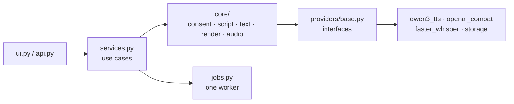
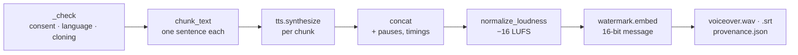

# 1. How a voiceover is made

This chapter follows one voiceover through the code: the app starting, a voice being saved, a script being
written and the audio being rendered. Every step names the file and function, so you can read along.



## The app starts

[`voiceover_studio/__main__.py`](../../voiceover_studio/__main__.py) is the entry point (`python -m
voiceover_studio`). It does three things:

```python
services = Services(Settings.from_env(), load_config())
app = create_app(services)                      # the HTTP API under /api
return gr.mount_gradio_app(app, build_ui(services), path="/", theme=THEME, css=CSS)
```

Two kinds of settings come in:

- **`Settings`** ([`settings.py`](../../voiceover_studio/settings.py)): deployment choices from environment
  variables, such as which voice model, which LLM endpoint, which bucket. `from_env()` maps `TTS_MODEL` to
  `tts_model` for every field of the dataclass. On AWS, these come from `/opt/voiceover/app.env`, which
  `deploy.sh` writes from your `.env` (secrets stay out of it; chapter 4).
- **`AppConfig`** ([`core/config.py`](../../voiceover_studio/core/config.py)): tuning from
  [`config.yaml`](../../config.yaml), such as the consent sentence, words per minute, the pause between
  sentences and the loudness target. Any value can be overridden with `VS__<SECTION>__<KEY>`.

Both the API and the UI get the **same `Services` object**. That's the main design rule of the app: the UI and the
API are thin, and every real action lives in [`services.py`](../../voiceover_studio/services.py).

## Providers are created only when needed

`Services` doesn't load any model when it starts. Each provider is a `cached_property`:

```python
@cached_property
def tts(self) -> TTSProvider:
    return self._tts or build_tts(self.settings)
```

So the first access builds it, later accesses reuse it, and tests can pass in fakes (`self._tts`). This matters
twice: the app starts in seconds, and if you pick a hosted provider, GPU libraries are never imported.

`build_tts` asks the **registry** ([`providers/registry.py`](../../voiceover_studio/providers/registry.py)) for
the class registered under the setting's name. Providers register themselves with a decorator:

```python
@register("tts", "qwen3_tts")
class Qwen3TTS(TTSProvider): ...
```

The registry imports a built-in provider's module only when it's selected. Heavy imports (`torch`, `qwen_tts`)
happen inside the provider's `_load()`, at first use.

Every provider implements an interface from [`providers/base.py`](../../voiceover_studio/providers/base.py) and
**declares its capabilities**: languages, whether it can clone, the reference length it wants, the most text it
takes per call, whether it runs locally. The core and the UI read those instead of assuming. For example, the
language list in the UI is `tts.capabilities().languages`.

## Saving a voice

The user records the consent sentence. `Services.add_voice(data)` takes the uploaded bytes:

1. **Convert.** Browsers record WebM/Opus, phones M4A. If the bytes aren't already 24 kHz mono 16-bit WAV,
   [`core/convert.py`](../../voiceover_studio/core/convert.py) runs `ffmpeg` to make them so.
2. **Check the quality.** `check_sample` in [`core/consent.py`](../../voiceover_studio/core/consent.py) trims the
   silence and measures the clip. *Problems* block saving; *warnings* don't:

   | Check | How | Result |
   |---|---|---|
   | Length | 5 to 15 seconds after trimming | problem |
   | Distortion | more than 0.1 % of samples at full scale | problem |
   | Too quiet | overall level below −35 dBFS | problem |
   | Background noise | the quietest 10 % of 20-ms frames are within 15 dB of the loudest 10 % | warning |

3. **Transcribe.** Whisper (`asr` provider, on the CPU) turns the recording into text.
4. **Check consent.** `record_consent` compares the transcript with the sentence, word by word:

   ```python
   SequenceMatcher(None, _words(expected), _words(heard), autojunk=False).ratio()
   ```

   Below `consent_match_threshold` (0.8) it raises `ConsentError` and nothing is saved. Above it, a
   `ConsentRecord` is created with an id, the score, the SHA-256 of the audio and a timestamp.
5. **Store.** Two objects: `voices/<consent_id>/sample.wav` and `voices/<consent_id>/consent.json`.

Later, `voice_reference(voice_id)` turns a saved voice into what the voice model needs: the audio file and **the
sentence itself as the transcript**. The model clones better when it knows exactly what was said, and the consent
design gives us that for free.

## Writing the script

`Services.draft_script(request)` calls `generate_script` in [`core/script.py`](../../voiceover_studio/core/script.py):

1. **`check_request`** refuses obvious impersonation requests with a regular expression ("in the voice of",
   "pretend to be"…) before anything reaches the model.
2. **`build_messages`** fills in the system prompt: write only spoken words, short sentences, numbers as they're
   spoken, never impersonate a real person, and reply `REFUSED: <reason>` for deceptive requests. The target
   length becomes a word count: `seconds × words_per_minute / 60` (150 words per minute by default).
3. The **`llm`** provider ([`openai_compat.py`](../../voiceover_studio/providers/openai_compat.py)) sends it to
   any OpenAI-compatible endpoint. On AWS that's vLLM on the same GPU. It also sends
   `chat_template_kwargs: {"enable_thinking": false}`, so Qwen3.5 answers directly instead of reasoning at length
   first.
4. **`parse_reply`** cleans what models like to add anyway (reasoning tags, markdown, "Narrator:" labels,
   `[music]` directions) and turns a `REFUSED:` reply into a `ScriptRefusedError` the UI can show.

The word count and the estimated duration come from [`core/text.py`](../../voiceover_studio/core/text.py).
Chinese and Japanese have no spaces, so there about two characters count as one spoken word.

## Rendering the voiceover

`Services.submit_render` doesn't render directly. It hands a function to the **job manager**
([`jobs.py`](../../voiceover_studio/jobs.py)), a thread pool with **one** worker: there's one GPU, so renders run
one at a time, and the UI polls the job for progress.

The work itself is `render_voiceover` in [`core/render.py`](../../voiceover_studio/core/render.py). Its docstring
is the whole pipeline: *chunk → speak → join → loudness → watermark → label → files*.



1. **`_check`** refuses to start without a consent id, with a provider that can't clone, or in a language the
   provider doesn't support. These checks are in the core on purpose: swapping the provider can't skip them.
2. **`chunk_text`** splits the script into sentences (abbreviations like "Dr." and decimals like "3.5" don't end
   a sentence). A sentence longer than the provider's limit is split at commas, then at spaces. One sentence per
   chunk gives natural pauses and one caption per sentence.
3. **`tts.synthesize`** speaks each chunk in the cloned voice. `progress(i + 1, total, chunk)` updates the job.
4. **`concat`** joins the clips with a 250-ms pause and records where each one starts and ends. Those timings
   become the caption times.
5. **`normalize_loudness`** measures integrated loudness with `pyloudnorm` and scales the audio to −16 LUFS (the
   usual target for online video), then keeps peaks below −1 dBFS.
6. **`watermarker.embed`** adds an inaudible AudioSeal watermark carrying a fixed 16-bit message. It runs after
   the loudness step, so nothing changes the audio after it's marked.
7. **Files.** `write_wav` writes 16-bit PCM with a RIFF `INFO` chunk ("AI-generated voice…", the watermark id, the
   software version). `make_cues` turns the timings into SRT captions, wrapping text at 42 characters and two
   lines, and splitting a long sentence's time in proportion to its text. `provenance.json` records the label,
   provider, consent id, watermark and loudness.

Back in `submit_render`, the three files are uploaded to `outputs/<id>/` with the voice's consent id as metadata,
and the UI downloads them from there.

## Storage

[`providers/storage.py`](../../voiceover_studio/providers/storage.py) has two implementations of the same four
methods (`put`, `get`, `delete`, `list`): local files for development and S3 on AWS. Keys are checked
(`_safe_key`), so a crafted voice id can't reach outside its folder. The bucket has no versioning, so
`delete_voice` really removes the recording (chapter 3).

## The HTTP API

[`api.py`](../../voiceover_studio/api.py) exposes the same use cases as JSON (`/api/voices`, `/api/scripts`,
`/api/plugins/{name}`, `/api/renders`, `/api/outputs/...`), with pydantic models for validation and plain-language
error messages. Interactive docs are at `/api/docs` while you're connected. It also has `/api/activity`, which the
instance's idle timer reads (chapter 4).

## How it's tested

[`tests/fakes.py`](../../tests/fakes.py) has a fake LLM (a fixed reply, or a function of the messages), a fake
voice model that speaks every word as 0.4 seconds of tone, and a fake watermarker. With those, the tests run the
whole flow (save a voice, write a script, render, download) through the real API in about 15 seconds:

```bash
uv run pytest tests/test_api.py -q
```

`scripts/smoke_models.py` does the same with the real models, on a CPU (slowly) or on the GPU.
