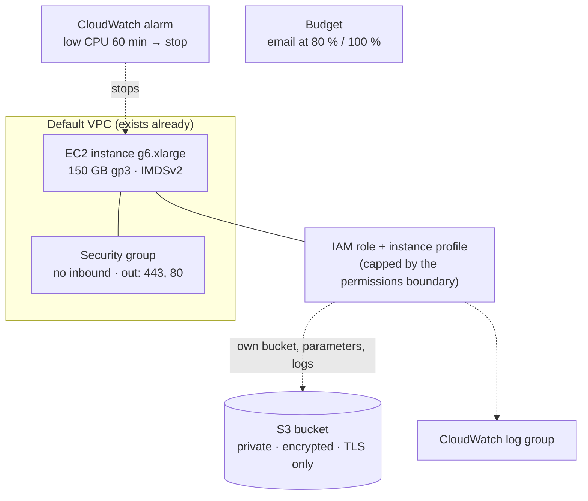

# 3. The infrastructure (Terraform)

Everything the studio needs in AWS is described in [`infra/terraform/`](../../infra/terraform/): about 400 lines
in eight files. This chapter goes through them in the order Terraform needs them, and explains why each setting
is there.

## Terraform in five minutes

- You **describe** the resources you want (`resource "aws_instance" "app" { … }`). Terraform works out what to
  create, change or delete to get there.
- **Data sources** (`data "aws_vpc" "default" { … }`) only **read** something that already exists.
- **Variables** are the inputs (instance type, budget email…). `deploy.sh` sets them from your `.env` as
  `TF_VAR_<name>` environment variables.
- **State** (`infra/terraform/terraform.tfstate`) is Terraform's record of what it created. It's local and
  git-ignored. Keep it: `destroy.sh` needs it to know what to delete.
- **`terraform plan`** shows the changes; **`terraform apply`** makes them. `deploy.sh` runs a plan, shows it to
  you, and applies only after you say yes.

## What gets created



## The account's rules come first

Terraform runs as the **deploy role**, not as an admin (the account setup in
[`infra/bootstrap/`](../../infra/bootstrap/README.md) created it). That role can only create resources with this
project's names and tag, only in one region, only four instance types, never an open inbound port. So several
"odd" choices below are simply what the role allows. If you change a name here, the role refuses.

## `versions.tf`: the provider and the project tag

```hcl
provider "aws" {
  region = var.region
  default_tags {
    tags = local.tags   # { project = "voiceover-studio" }
  }
}
```

`default_tags` puts `project=voiceover-studio` on every resource Terraform creates. Two things depend on it: the
deploy role only allows creating resources that carry it, and `destroy.sh` searches for it to prove everything is
gone. The provider version is pinned in `.terraform.lock.hcl`, which is committed.

## `variables.tf`: inputs that fail early

Each variable has a description and, where it matters, a **validation** that mirrors the account's guardrails:

```hcl
validation {
  condition     = contains(["g6.xlarge", "g5.xlarge", "g4dn.xlarge", "t3.medium"], var.instance_type)
  error_message = "instance_type must be one of g6.xlarge, g5.xlarge, g4dn.xlarge, t3.medium."
}
```

AWS would deny another type anyway, but only after the plan, with a less helpful `AccessDenied`. A test
(`tests/test_bootstrap_policies.py`) checks that this list and the guardrail's list stay the same. The disk size
is limited to 30 to 200 GB for the same reason.

## `main.tf`: names that match the permissions

```hcl
bucket_name  = "voiceover-studio-${local.account_id}-${var.region}"
boundary_arn = "arn:${local.partition}:iam::${local.account_id}:policy/voiceover-studio-instance-boundary"
```

Bucket names are global across all of AWS, so the account id and region make it unique. The names follow the
patterns the deploy role allows (`voiceover-studio-*`, `/voiceover-studio/*`), which is why they're constants, not
variables.

## `network.tf`: no network to build

The studio uses the **default VPC** that every AWS account already has. Creating a VPC, subnets and a NAT gateway
would cost money (a NAT gateway is about $32 a month) and isn't needed: the instance only makes outbound
connections.

Two details:

- **Pick a zone that has the GPU.** Not every availability zone offers every instance type.
  `aws_ec2_instance_type_offerings` lists the zones that do, and the subnet is chosen from those. A precondition
  turns "no matching subnet" into a readable error instead of an index error.
- **A security group with no inbound rules.** Nothing on the internet can connect to the instance. You reach the
  app through Systems Manager instead (chapter 4). Outbound, it allows port 443 (AWS APIs, model and package
  downloads) and port 80, because the Debian and Ubuntu package mirrors used while building the image are plain
  HTTP.

## `iam.tf`: what the instance itself may do

The instance needs AWS permissions too: to read and write its bucket, read its secrets, write logs and talk to
Systems Manager. It gets them from an **IAM role** attached through an **instance profile**:

```hcl
resource "aws_iam_role" "instance" {
  name                 = "voiceover-studio-instance"
  path                 = "/voiceover-studio/"
  permissions_boundary = local.boundary_arn
  # ...
}
```

The **permissions boundary** is the important line. It's a policy the account setup created, and it caps what
this role can ever be allowed: even if someone added a broader policy, the role still couldn't reach beyond the
project's bucket, parameters, logs and the SSM agent. The deploy role is only allowed to create roles that carry
this boundary, so a mistake (or a compromised deploy) can't create a powerful role.

The role's own **inline policy** lists exactly what the app uses (`s3:GetObject`, `s3:PutObject`… on its bucket;
`ssm:GetParameter` on `/voiceover-studio/*`; three log actions on its log group), and the AWS-managed
`AmazonSSMManagedInstanceCore` lets the SSM agent register the instance.

## `storage.tf`: a private bucket

| Resource | Why |
|---|---|
| `aws_s3_bucket` with `force_destroy = true` | `destroy.sh` offers a download first, then removes the bucket and everything in it |
| `aws_s3_bucket_public_access_block` (all four on) | The bucket can never be made public, even by mistake |
| `aws_s3_bucket_ownership_controls` `BucketOwnerEnforced` | ACLs are switched off; only IAM policies decide access |
| `aws_s3_bucket_server_side_encryption_configuration` `AES256` | Encrypted at rest with S3-managed keys: no KMS key to pay for or manage |
| `aws_s3_bucket_policy` denying `aws:SecureTransport = false` | Only HTTPS requests are accepted |
| `aws_s3_bucket_lifecycle_configuration` | Old code bundles (`deploy/`) expire after 30 days; unfinished uploads are cleaned up after a day |

**No versioning, on purpose.** With versioning on, deleting an object keeps the old version. Voice recordings are
biometric-like data: when you delete a voice in the app, the recording must really be gone.

## `compute.tf`: the GPU server

**The image (AMI).** For the GPU profile, the newest *Deep Learning Base OSS Nvidia Driver GPU AMI (Ubuntu
24.04)*, which comes with the NVIDIA driver, Docker and the NVIDIA Container Toolkit. Everything else runs in
containers, so a bigger image with PyTorch preinstalled isn't needed. `owners = ["amazon"]` matters: the
guardrails deny images from any other owner, which keeps paid Marketplace images out.

**The instance.** Each setting has a reason:

| Setting | Why |
|---|---|
| `associate_public_ip_address = true` | Outbound internet without a NAT gateway; with no inbound rules, nobody can connect in |
| `instance_initiated_shutdown_behavior = "stop"` | When the idle timer shuts the machine down, it's **stopped** (disk kept), not terminated |
| `metadata_options { http_tokens = "required" }` | Instance metadata only with IMDSv2 tokens, which blocks a class of credential-theft attacks |
| `http_put_response_hop_limit = 2` | The app runs in a container, one network hop further away; it needs the metadata service for the role's credentials |
| `root_block_device`: gp3, 150 GB, 3000 IOPS, 125 MB/s, encrypted | gp3 includes 3000 IOPS and 125 MB/s for free; the guardrails deny anything that costs extra. 150 GB fits the AMI, about 30 GB of images and 13 GB of models |
| `user_data` (from `user-data.sh.tftpl`) | First boot only: installs the idle auto-stop timer, so the instance stops itself even if no deploy ever finishes |

**Lifecycle rules.** Three of them prevent expensive surprises:

```hcl
lifecycle {
  ignore_changes       = [ami, user_data]
  replace_triggered_by = [terraform_data.root_volume_size]
  precondition { ... }
}
```

- `ignore_changes = [ami, …]`: when AWS publishes a newer AMI, the data source finds it, but the instance isn't
  replaced (which would mean downloading the models again). You replace it on purpose with
  `deploy.sh --replace-instance`.
- `replace_triggered_by`: the deploy role isn't allowed to resize a disk in place (`ec2:ModifyVolume`), so a new
  `ROOT_VOLUME_GB` replaces the instance instead. The plan shows "must be replaced", and you confirm it.
- The preconditions catch a disk smaller than the image's snapshot, and a GPU instance type with the CPU profile
  (or the reverse), with a clear message.

## `monitoring.tf`: logs, a safety net and a budget

- **Log group** `/voiceover-studio/app`, kept 14 days. Docker sends the containers' output there.
- **The low-CPU alarm** is the backstop for the idle timer. If average CPU stays below 5 % for 12 five-minute
  periods, its action `arn:aws:automate:<region>:ec2:stop` stops the instance. One subtle setting:

  ```hcl
  treat_missing_data = "notBreaching"
  ```

  A stopped instance sends no data. Treating missing data as "fine" resets the alarm while the instance is
  stopped, so it can fire again after the next start. (CloudWatch alarms act only when they *change* state.)
- **The project budget** emails you at 80 % of actual spending and at 100 % of the forecast. Billing data lags by
  up to a day, which is why it's the last line of defence, not the first.

## `outputs.tf`

The instance id, bucket name, region, zone, AMI and log group. The scripts read them with
`terraform output -raw instance_id`, so nothing is copied by hand.

## What Terraform doesn't do

- **Install the app.** Terraform creates an empty server. Building the image, downloading models and starting the
  containers happen on the instance, run by `deploy.sh` (chapter 4). Keeping them apart means a code change
  doesn't touch the infrastructure, and an infrastructure change doesn't reinstall the app.
- **Store secrets.** Values in Terraform end up in the state file in plain text. Secrets go to SSM Parameter Store
  through `scripts/secret.sh`, and the app reads them at runtime.
- **Set up the account.** The deploy role, the guardrails and the GPU quota come from
  [`infra/bootstrap/`](../../infra/bootstrap/README.md), run once by an admin.

## Try it

```bash
./scripts/deploy.sh --infra-only     # plan and apply the infrastructure only
```

Change `BUDGET_MONTHLY_USD` in `.env` and run it again: the plan shows exactly one change, to the budget. Change
`IDLE_STOP_MINUTES` and the plan shows **no** change: it only feeds the first-boot script, which `ignore_changes`
skips (each deploy updates the timer on the instance instead, chapter 4). Change `ROOT_VOLUME_GB` and the plan
shows a replacement. Reading a plan before saying yes is the habit this whole setup is built around.
