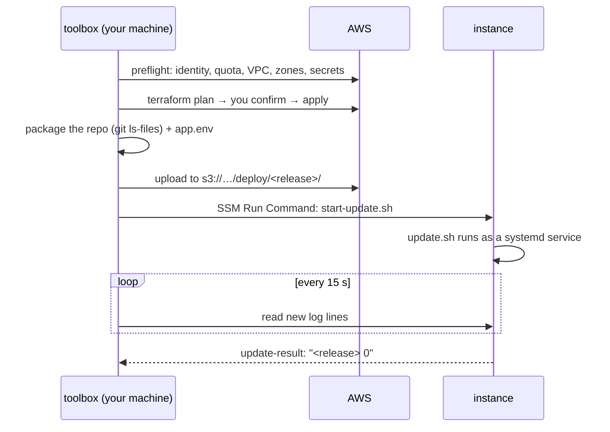

# 4. Deploying and running it

Chapter 3 covered what Terraform creates. This chapter follows the commands you actually type: what
`deploy.sh` does from your laptop to a running app, how `connect.sh` reaches a server with no open ports, how the
instance stops itself, and how `destroy.sh` proves everything is gone.

## Two layers of scripts

Every command in `scripts/` is a three-line wrapper:

```bash
source "$(dirname "$0")/lib/host.sh"
run_in_toolbox deploy.sh "$@"
```

**[`scripts/lib/host.sh`](../../scripts/lib/host.sh)** runs on your machine, on whatever bash you have (macOS
still ships bash 3.2, Windows has Git Bash), so it does as little as possible:

1. Checks that Docker and the AWS CLI are there.
2. Gets **short-lived credentials** for the deploy role: `aws configure export-credentials --profile voiceover`.
   That's where the AWS CLI asks for your MFA code. They expire within an hour.
3. Builds the **toolbox image** if it isn't there yet ([`toolbox/Dockerfile`](../../toolbox/Dockerfile):
   Terraform, the AWS CLI and the Session Manager plugin, at pinned versions). The image tag is a checksum of the
   Dockerfile, so changing the Dockerfile rebuilds it automatically.
4. Runs the real script inside the toolbox, with the repo mounted at `/work` and the credentials passed by **name**
   (`-e AWS_SESSION_TOKEN`), so their values never appear in a process list. The container never sees `~/.aws`.

The Windows details are worth a look. Git Bash rewrites anything that looks like a Unix path when it starts a
Windows program, so `-w /work` became `C:/Program Files/Git/work` in the dry run. The fix is to give Docker a
Windows path (`pwd -W`), use `--mount type=bind,source=…,target=/work`, and set the working directory in the
image instead of with `-w`.

**[`scripts/toolbox/`](../../scripts/toolbox/)** holds the real logic, on bash 5 with known tool versions.
[`lib.sh`](../../scripts/toolbox/lib.sh) is shared by all of them. Its `load_env` reads `.env` **as data**
(`KEY=value` lines, checked with a regular expression) instead of running it with `source`, so a stray character
in `.env` can't execute anything.

## `deploy.sh`, step by step



**1. Preflight** ([`preflight.sh`](../../scripts/toolbox/preflight.sh)). It checks before anything changes: are
you the deploy role (not root, not an admin)? Is the GPU quota at least 4 vCPUs? Does the default VPC exist? Which
zones offer the instance type? Do the secret parameters named in `.env` exist? Each failure says how to fix it.

**2. Terraform.** `terraform plan -detailed-exitcode` exits with 0 for "no changes" and 2 for "changes", so the
script only asks you to confirm when there's something to apply.

**3. Package the code.**

```bash
git ls-files -z --cached --others --exclude-standard | tar --null --files-from=- -czf build/app.tar.gz
```

`git ls-files` lists tracked and new files but skips everything in `.gitignore`. So your uncommitted changes go
along (handy while you experiment), and `.env`, voice recordings and Terraform state never do. Next to it goes
`app.env`, the non-secret settings for the app.

**4. Start the install on the instance.** The deploy role has no SSH key, and the instance has no open port. So
the script uses **SSM Run Command**: AWS delivers a shell command to the SSM agent on the instance, which runs it
as root. Two gotchas from the dry run shaped how it's used:

- **SSM runs commands with `/bin/sh`, which is `dash` on Ubuntu.** `set -o pipefail` doesn't exist in dash, so the
  first deploy failed on line one. `run_remote` now writes the command to a temporary file and runs it with bash.
- **One long command hit its time limit.** A first install takes about 25 minutes (more on a slow day), and the
  deploy role's session lasts one hour. So the command only starts the install and returns.

[`infra/instance/start-update.sh`](../../infra/instance/start-update.sh) starts `update.sh` as a transient
**systemd service**:

```bash
systemd-run --unit=voiceover-update --collect --quiet \
  --setenv=PATH=… --setenv=HOME=/root --setenv=AWS_DEFAULT_REGION="$AWS_DEFAULT_REGION" \
  /bin/bash "$ROOT/releases/$RELEASE/infra/instance/update.sh" "$BUCKET" "$RELEASE"
```

The install now runs under systemd, independent of SSM. `deploy.sh` then follows the log with short SSM commands
every 15 seconds (`follow_update`), and finally reads `/opt/voiceover/update-result`. If you press Ctrl+C or your
session expires, only the watching stops: `deploy.sh --follow` picks it up again.

## On the instance: `update.sh`

[`infra/instance/update.sh`](../../infra/instance/update.sh) is part of every release, so changes to it ship with
the code. It's safe to re-run. In order:

1. Downloads `app.env`, and reads the Hugging Face token (if any) from SSM Parameter Store into a root-only
   `secrets.env`.
2. Installs Docker Compose if the AMI lacks it, checksum-verified.
3. Installs or updates the **idle auto-stop** timer.
4. **Checks the disk.** Downloading an image needs room for the compressed and the unpacked copy at the same time;
   the first install ran out of space at 100 GB. It estimates what's needed for images that aren't there yet and
   stops with a clear message if there isn't room.
5. Pulls the vLLM image and **builds the app image** ([`Dockerfile`](../../Dockerfile): Python 3.12, ffmpeg, and
   `uv sync --locked --extra gpu`, so the image gets exactly the versions in `uv.lock`).
6. **Prefetches the models**: `python -m voiceover_studio.prefetch` downloads *and loads* the voice model, Whisper
   and the watermark model. Loading them proves they fit and run before anyone opens the page.
7. **Starts everything** with `docker compose up --wait`, which waits for both containers' health checks, then
   keeps the current release and the two before it, and prunes old images.

When it exits, a trap writes `"<release> <exit code>"` to `update-result`, and on failure the disk usage, so the
reason is in the log.

## Two containers on one GPU

[`docker/compose.yaml`](../../docker/compose.yaml) runs:

- **`llm`**: the official `vllm/vllm-openai` image serving the 4-bit Qwen3.5-9B. The flags say what this setup
  needs: `--gpu-memory-utilization=0.5` (take half the GPU, the voice model uses the rest),
  `--max-model-len=8192` (scripts are short, so the cache can be small), `--language-model-only` (Qwen3.5 can read
  images; we skip that part), `--default-chat-template-kwargs={"enable_thinking": false}`, and `--revision` pinned
  to the tested model version.
- **`app`**: the studio. Its port is published on `127.0.0.1:7860` only, on the instance's own loopback. It waits
  for the LLM to be healthy (`depends_on: … condition: service_healthy`).

Both send their output to CloudWatch with the `awslogs` driver, and both reserve the GPU through the NVIDIA
Container Toolkit (`deploy.resources.reservations.devices`).

## `connect.sh`: reaching a server with no open ports

**SSM Session Manager port forwarding** opens an encrypted tunnel through AWS from your machine to a port on the
instance. Nothing listens on the internet; the SSM agent on the instance makes an *outbound* connection to AWS.

There's one wrinkle: the tunnel runs inside the toolbox container, but your browser is outside it. So inside the
container, the Session Manager plugin listens on port 17860, and `socat` forwards the container's published
port 7860 to it:

```bash
socat TCP-LISTEN:7860,fork,reuseaddr TCP:127.0.0.1:17860 &
aws ssm start-session --target "$id" --document-name AWS-StartPortForwardingSession \
  --parameters '{"portNumber":["7860"],"localPortNumber":["17860"]}'
```

The host wrapper publishes that port as `127.0.0.1:7860` on your machine, and the browser gets
`http://localhost:7860`.

## The instance stops itself

Two independent mechanisms, so one failing doesn't cost money:

1. **The idle timer.** A systemd timer runs [`idle-stop.sh`](../../infra/instance/idle-stop.sh) every five
   minutes. It asks the app for `/api/activity` (seconds since the last real action, and whether a render is
   running). After `IDLE_STOP_MINUTES` without activity, it runs `systemctl poweroff`, and because the instance's
   shutdown behaviour is `stop`, the instance stops rather than disappears. It skips the check during an install,
   and if you're working in a shell on the instance, `sudo touch /run/voiceover/keep-awake` pauses it (for at most
   eight hours, so a forgotten flag can't keep the GPU running).
2. **The CloudWatch alarm** from chapter 3: 60 minutes of near-zero CPU stops the instance from outside.

## `destroy.sh`: remove everything, then prove it

1. Offers to download your voices and outputs to `backups/` (they include your voice recording: keep them private).
2. `terraform destroy`.
3. Removes what Terraform doesn't own: secrets under `/voiceover-studio/`, and any snapshots or images with the
   project tag.
4. **Verifies.** It asks the Resource Groups Tagging API for anything still tagged `project=voiceover-studio`. That
   index lags behind deletions (in the dry run it still listed instances deleted hours earlier), so each listed
   resource is confirmed with its own service before it counts as left over:

   ```bash
   *:ec2:*:volume/*) probe aws ec2 describe-volumes --volume-ids "$id" ;;
   arn:aws*:s3:::*)  probe aws s3api head-bucket --bucket "${arn##*:::}" ;;
   ```

   `probe` treats only a clear "not found" as gone. Any other error, such as an expired session, counts as "still
   there", so a real leftover is never hidden. IAM roles and budgets aren't in the tagging index, so they're checked
   by name.

## The one-time account setup

[`scripts/bootstrap.sh`](../../scripts/bootstrap.sh) runs with an admin profile, once per account. It follows the
same pattern as everything else: check every piece, list what would change (policy differences as a diff), ask,
apply. It has its own guide: [`infra/bootstrap/README.md`](../../infra/bootstrap/README.md).
